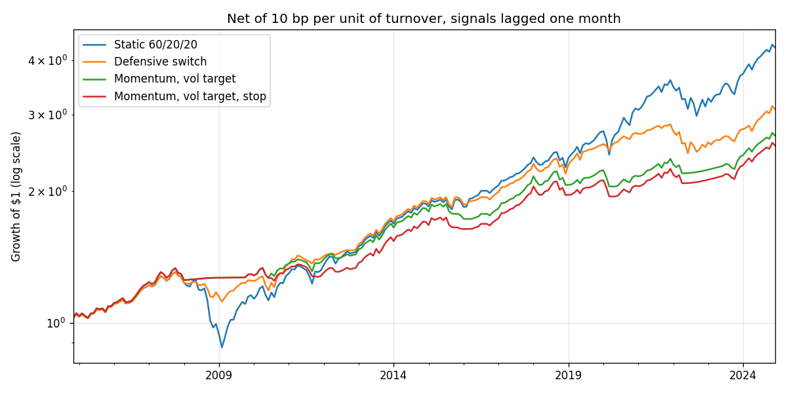

# cornell-case-competition

[](https://github.com/aakashbansalgit/cornell-case-competition/actions/workflows/tests.yml)

Rebuilt without look-ahead, momentum with a volatility target cuts the worst drawdown of a 60/20/20 portfolio from 33% to 8% at almost the same Sharpe ratio.


Defensive allocation strategies for the 2025 Cornell Investment Portfolio Case Competition, where the case was to design a defensive equity fund that holds up in sell-offs without giving away too much of the market's return. Team 19 was Aakash Bansal, Jaehong Park, Piyush Sen and Saurabh Jamadagni.

This is a rebuild of our submission. Going back over it afterwards, I found that the competition notebook set each month's allocation using that same month's return, and its stop-loss swapped out a month's loss after it had happened. Both flatter a backtest badly. Here every allocation for month t is decided from data that existed at the end of month t-1, and `tests/test_no_lookahead.py` checks that by shocking a month's returns and confirming no weight up to that month moves. The competition data isn't public, so the returns are rebuilt from SPY and AGG total returns and the 3-month T-bill rate from FRED, which starts the sample in 2003.

## Strategies

All are rebalanced monthly and pay 10 bp per unit of turnover.

The benchmark is a static 60/20/20 mix of equities, bonds and T-bills.

The defensive switch holds 60/20/20 and moves to 20/35/45 after three losing equity months in a row, or when trailing 12-month equity volatility runs above 1.5 times its own history to date. It moves back after a positive month with volatility back to normal.

Momentum with a volatility target holds equities only when their trailing 12-month return beats T-bills. When it does, the equity weight is 70% scaled down so that trailing volatility on that sleeve stays near 8% a year, with 15% in bonds and the rest in T-bills. Otherwise it holds T-bills. The last variant adds a stop that moves to T-bills for a month whenever the strategy ends a month more than 5% below its peak.

## Results, November 2004 to December 2024

| | Return | Volatility | Sharpe | Max drawdown | Worst month | Turnover a year |
|---|---|---|---|---|---|---|
| Static 60/20/20 | 7.5% | 9.2% | 0.66 | 32.8% | -10.4% | 0.0 |
| Defensive switch | 5.7% | 6.5% | 0.65 | 14.5% | -6.0% | 0.4 |
| Momentum, vol target | 5.0% | 5.4% | 0.64 | 8.3% | -4.8% | 1.2 |
| Momentum, vol target, stop | 4.7% | 5.3% | 0.60 | 8.3% | -4.8% | 1.3 |

Momentum with the volatility target cuts the worst drawdown from 33% to 8% at almost the same Sharpe ratio. It gives up about two and a half points of return a year for it. In October 2008, when SPY lost 16.5%, it was flat, because the 12-month signal had already moved it out of equities. March 2020 was the exception: the crash came after a strong year, the signal was still long, and it lost 4.8% in the month. The stop-loss adds turnover and nothing else, since the momentum rule has usually left before a 5% drawdown builds.

`results/worst_months.csv` has every strategy's return in the six worst SPY months of the sample, and `figures/` has the growth and drawdown charts.

The parameters, 70% maximum equity, 8% target volatility and the 20/35/45 stress mix, are the ones we chose during the competition on its 1976 to 2024 data, which overlaps this sample. Treat the results as in-sample for the parameters, though not for the signals.

## Running it

```
pip install numpy pandas matplotlib yfinance
python backtest.py
python tests/test_no_lookahead.py
```

The first run downloads prices and caches them in `data/returns.csv`.
